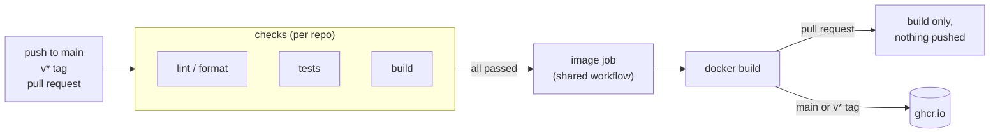
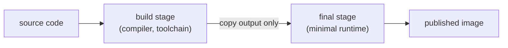
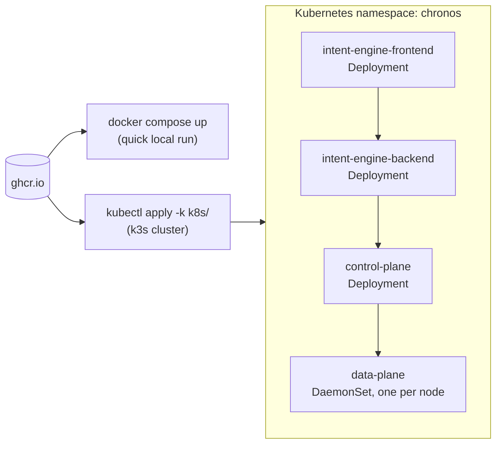

# Infrastructure

How the Chronos repositories are built, published and run.

## Repositories

| Repo | Language | Image | Port |
|---|---|---|---|
| `intent-engine-frontend` | TypeScript (Next.js) | `ghcr.io/chronos-packet-scheduler/intent-engine-frontend` | 3000 |
| `intent-engine-backend` | Python (FastAPI, uv) | `ghcr.io/chronos-packet-scheduler/intent-engine-backend` | 8000 |
| `control-plane` | Go | `ghcr.io/chronos-packet-scheduler/control-plane` | 8080 |
| `data-plane` | C (eBPF/XDP) + Rust (agent) | `ghcr.io/chronos-packet-scheduler/data-plane` | 9445 |
| `deploy` | Compose + Kubernetes manifests | — | — |
| `.github` | shared workflow, org profile | — | — |

Every service answers `GET /healthz` with HTTP 200. Kubernetes uses it for liveness and readiness probes.

## Pipelines

Each service repo has `.github/workflows/ci.yml`. It runs the repo's own checks, then calls the shared workflow `.github/workflows/publish-image.yml` from the `.github` repo to build and publish the Docker image.

What "checks" runs in each repo:

| Repo | Checks |
|---|---|
| `control-plane` | `go vet`, `go test`, `go build` |
| `data-plane` | clang compiles `bpf/*.c` and `examples/*.c`; `cargo fmt --check`, `cargo clippy`, `cargo test` |
| `intent-engine-backend` | `ruff check`, `ruff format --check`, `pytest` |
| `intent-engine-frontend` | `npm run typecheck`, `npm run build` |
| `deploy` | validates `compose.yaml` and `k8s/` (no image) |

### Image tags

| Event | Tags |
|---|---|
| push to `main` | `main`, `latest`, `sha-<commit>` |
| tag `v1.2.3` | `1.2.3`, `1.2`, `sha-<commit>` |
| pull request | built, not pushed |

To release: `git tag v0.1.0 && git push origin v0.1.0`.

### Docker images

Every Dockerfile is a multi-stage build: an early stage has the compilers and build tools, and the last stage copies in only the build output. Only the last stage is published.

### Dependabot

Every repo has `.github/dependabot.yml`. Once a week it opens PRs for new versions of the language packages, Docker base images and GitHub Actions. Those PRs go through the same pipeline before you merge them.

## Running the system

The `deploy` repo pulls the published images and runs them locally (e.g. on Rancher Desktop).

The arrows inside the cluster show the intended communication between components.

See the `deploy` README for the exact commands.
